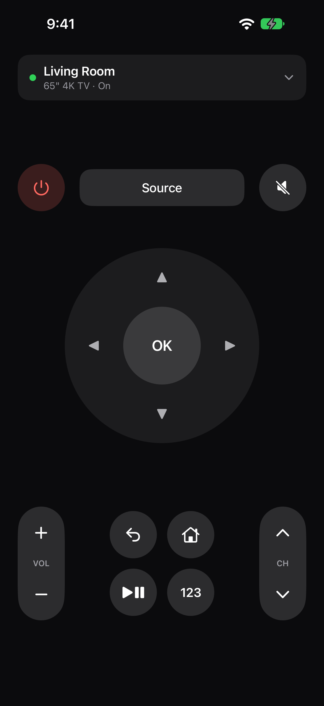

# Free Remote for Samsung TV

A free, open-source iPhone app that finds Samsung Smart TVs (Tizen) on your Wi-Fi network and controls them
like the physical remote. No ads, no accounts, no tracking: the app only talks to TVs on your local network.



More screenshots: [`AppStore/screenshots/`](AppStore/screenshots/).

## Features

- Automatic discovery of Samsung TVs on the local network (Bonjour, plus SSDP in builds with the multicast
  entitlement), and "Add TV by IP address"
- Power on/off (state-aware; wakes TVs from network standby; Wake-on-LAN from deep standby in builds with the
  multicast entitlement), volume, mute, channel up/down
- Circular D-pad with OK, Back, Home, Play/Pause
- Source, with a long press for HDMI 1–4
- Number pad, and text entry when the TV shows an on-screen keyboard
- Hold-to-repeat for volume, channel and arrows
- Remembers TVs between launches, including while they are asleep
- Your own names for TVs, synced across your devices with iCloud
- One-time pairing per TV (choose "Allow" on the TV); haptics, VoiceOver labels, Dynamic Type, dark mode

## Requirements

- Works with Samsung Smart TVs running Tizen, 2022 and newer. Many 2018–2021 models also work. Tested on 2022, 2024 and 2026 models.
- iPhone and TV on the same Wi-Fi/local network. Guest or isolated (client-isolation) networks are not
  supported.
- Choose "Allow" on the TV the first time the app connects.
- To turn the TV on from the app, enable the TV's "Power On with Mobile" (network standby) setting.
  Version 1.0: a TV that has been off for a long time may need its own remote to turn on.
- Version 1.0: automatic discovery needs AirPlay on in the TV's settings (on by default); otherwise add the
  TV by its IP address.
- Local Network permission granted on the iPhone (Settings > Privacy & Security > Local Network).
- iPhone with iOS 27 or later.

## Privacy

The app collects no data. There is no analytics, advertising, tracking or crash reporting, and no third-party
code. It only contacts private (RFC 1918) or link-local addresses on your network. Control traffic uses TLS
with the TV's certificate pinned on first use; trust checks are never disabled. Pairing tokens live in the
Keychain on the device; TV names you choose sync through your own iCloud. See the
[privacy policy](docs/privacy/index.md).

## Building

You need macOS with **Xcode 27.2 or later** and the iOS 27.0 simulator runtime.

1. Clone the repository.
2. Copy `Config/Local.example.xcconfig` to `Config/Local.xcconfig` (git-ignored) and set your own
   `DEVELOPMENT_TEAM` and `PRODUCT_BUNDLE_IDENTIFIER`. You can skip this to build for the simulator only.
3. Open `FreeRemote.xcodeproj` and run the `FreeRemote` scheme.

The multicast networking entitlement (SSDP discovery, broadcast Wake-on-LAN) must be granted to your team by
Apple. Without it (the default, `FREE_REMOTE_MULTICAST = NO`), the app signs with
`App/FreeRemote/FreeRemote.entitlements`, discovers TVs over Bonjour only, wakes TVs from network standby
over the control channel, and sends Wake-on-LAN only directly to the TV's last known address (which works
while the TV's hardware address is still cached on the network). Once your team has the entitlement, set
`FREE_REMOTE_MULTICAST = YES` in `Config/Local.xcconfig`: that signs with
`App/FreeRemote/FreeRemote+Multicast.entitlements` and turns on SSDP and broadcast Wake-on-LAN.

### Tests

```sh
# SamsungTVKit (protocol, discovery, pairing, power logic)
swift test --package-path SamsungTVKit

# App unit and UI tests
xcodebuild test -project FreeRemote.xcodeproj -scheme FreeRemote \
  -destination 'platform=iOS Simulator,name=iPhone 17 Pro,OS=27.0' -parallel-testing-enabled NO
```

### Other tools

- `scripts/screenshots.sh` regenerates the App Store screenshots from demo mode (launch argument `-demo`,
  which shows fictional TVs).
- `swift build --package-path SamsungTVKit --product tvprobe` builds a command-line probe for checking
  protocol behaviour on a real TV (see [`docs/protocol-notes.md`](docs/protocol-notes.md)).
- `swift scripts/render-icon.swift` regenerates the app icon.

## Project layout

| Path | Contents |
|---|---|
| `SamsungTVKit/` | Swift package: discovery, device info, pairing and the control channel, power, Wake-on-LAN; `tvprobe` CLI |
| `App/FreeRemote/` | SwiftUI app: app model, views, stores (known TVs, iCloud labels, Keychain), demo mode, assets |
| `App/FreeRemoteTests/`, `App/FreeRemoteUITests/` | App unit tests and UI/screenshot tests |
| `Config/` | Shared build settings; your local signing settings |
| `AppStore/` | App Store screenshots (generated by `scripts/screenshots.sh`) |
| `docs/` | Protocol notes, privacy policy (published with GitHub Pages), manual test checklist, design docs |
| `scripts/` | Screenshot and icon scripts |

## Contributing

Contributions are welcome — see [CONTRIBUTING.md](CONTRIBUTING.md). To report a problem with a particular TV,
use the "TV compatibility" issue template.

## License

[MIT](LICENSE).

## Trademarks

Not affiliated with or endorsed by Samsung. Samsung and Tizen are trademarks of Samsung Electronics Co., Ltd.
