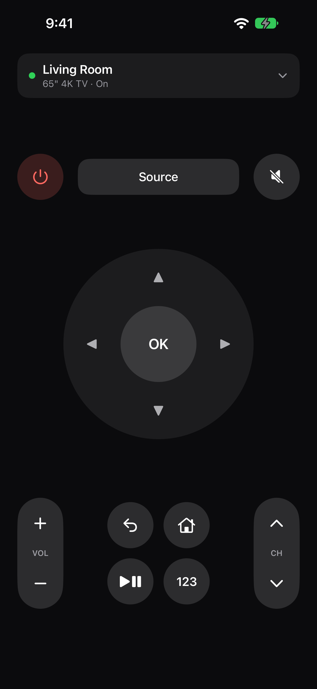

# Free Remote for Samsung TV

A free iPhone remote for Samsung Smart TVs (Tizen). It finds your TV on your Wi-Fi network and works like the
remote that came with it: power, volume, channels, the arrow pad, Source and HDMI inputs, a number pad, and
typing into the TV's search boxes. No ads, no accounts, no tracking.

- [Privacy Policy](privacy/)
- [Support and bug reports](https://github.com/guilhermechapiewski/samsung-free-remote-ios-app/issues)
- [Source code](https://github.com/guilhermechapiewski/samsung-free-remote-ios-app) (MIT license)

**Requirements:** an iPhone with iOS 27 or later, and a Samsung Smart TV running Tizen on the same Wi-Fi
network. To turn the TV on from the app, turn on the TV's "Power On with Mobile" setting.

Not affiliated with or endorsed by Samsung. Samsung and Tizen are trademarks of Samsung Electronics Co., Ltd.
